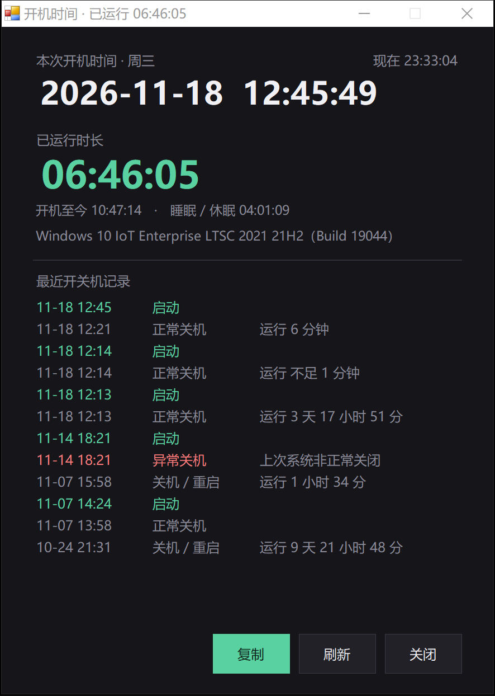

# BootTime · 一键查看 Windows 开机时间

双击就能看到：本次开机时刻、真实运行时长（不含睡眠）、当前时间、睡眠 / 休眠时长，以及最近的开关机记录。



## 下载

到 [Releases](../../releases) 下载 `BootTime.exe` —— 单文件、免安装，Windows 10 / 11 自带 .NET Framework 4.x 即可运行。

也可以自己编译：

```powershell
powershell -ExecutionPolicy Bypass -File build.ps1
```

脚本会生成图标、编译出 `BootTime.exe`，并在桌面创建「开机时间」快捷方式。

## 用法

| 操作 | 说明 |
| --- | --- |
| 双击运行 | 启动即显示数据 |
| `Esc` | 关闭窗口 |
| `Ctrl+C` 或「复制」 | 把开机时间、运行时长、睡眠时长、系统版本写入剪贴板 |
| `刷新` | 重新向系统取一次开机记录与事件日志 |

## 显示项与数据来源

| 显示项 | 来源 |
| --- | --- |
| 本次开机时间 | WMI `Win32_OperatingSystem.LastBootUpTime`，取不到时退回系统计时器 |
| 已运行时长 | `QueryUnbiasedInterruptTime()`，**不含**睡眠 / 休眠 |
| 开机至今 | 当前时间 − 开机时间（真实经过的墙钟时间） |
| 睡眠 / 休眠 | 开机至今 − 已运行时长 |
| 最近开关机记录 | 系统事件日志 `6005`（启动）、`6006`（正常关机）、`1074`（用户 / 程序发起关机）、`6008` 与 `Kernel-Power 41`（异常关机） |

界面按 DPI 显式缩放，150% / 200% 缩放下文字和按钮都不糊、不挤。

## 说明与限制

- 读取系统事件日志一般不需要管理员权限；若你的账户读不到，请以管理员身份运行，窗口内会给出提示。
- 如果本次开机后没有睡眠 / 休眠过，睡眠时长会显示 `00:00:00`。
- 开启了「快速启动」（Fast Startup）时，关机是混合关机，事件日志里的开关机记录可能和直觉略有差异。
- 事件日志会被系统滚动覆盖，太久以前、或日志被清理过的记录查不到。
- 程序只用 `System` 事件日志做只读查询，不写任何配置、不联网。

## 目录结构

```
BootTime.cs   主程序（WinForms，单文件）
build.ps1     构建脚本：生成 app.ico → 编译 exe → 创建桌面快捷方式
app.ico       构建产物（由 build.ps1 生成）
preview.png   截图
```

## English

A tiny WinForms utility for Windows: shows the exact boot time, real uptime (excluding sleep/hibernate), current time, sleep time, and recent boot/shutdown history read from the System event log. Download `BootTime.exe` from Releases — no install needed.
